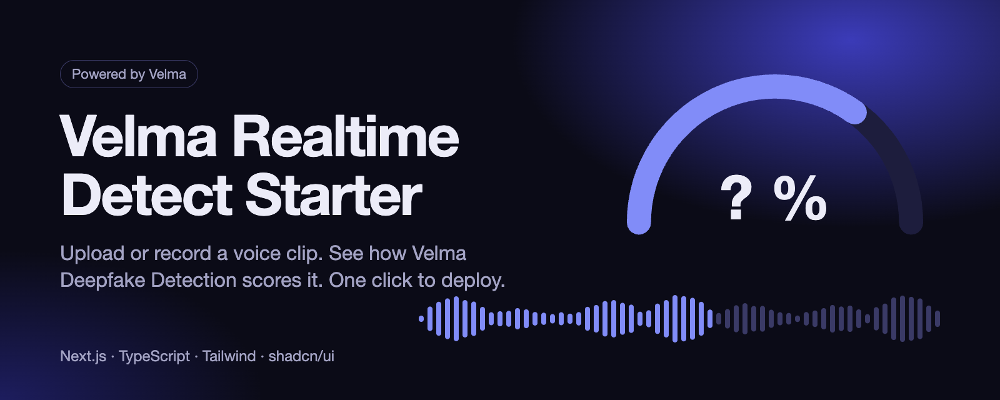
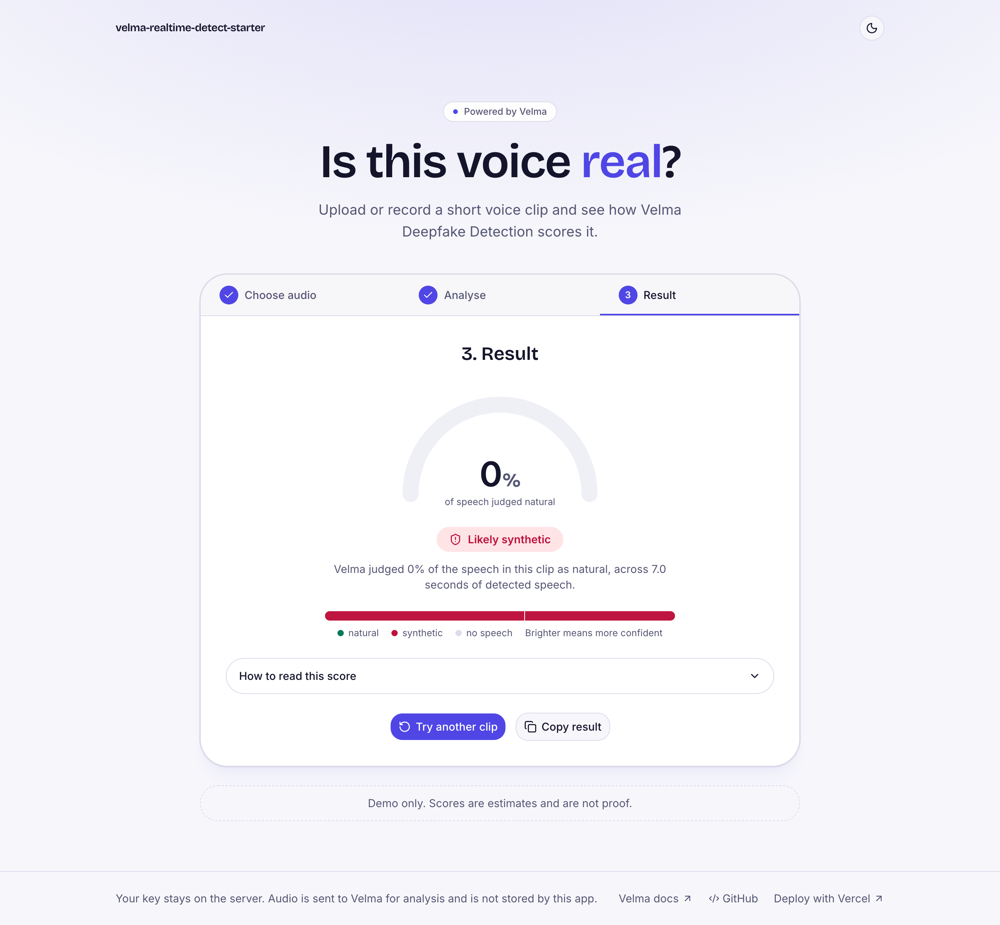

<p align="center">
  
</p>

# Velma Realtime Detect Starter

A small Next.js app that sends a voice clip to Modulate's Velma Deepfake Detection API and shows what comes back. Upload a file, record from the microphone or pick a sample, press Analyse, and read the result on a meter with a plain label.

**This version analyses the clip after you finish. It does not stream live audio.** See [Batch or streaming](#batch-or-streaming) for why.

<p align="center">
  
</p>

The result screenshots use a clip made with a text-to-speech voice, so the clip is synthetic by construction.

> Demo only. Scores are estimates and are not proof.

## Table of contents

- [Get started in three steps](#get-started-in-three-steps)
- [Run locally](#run-locally)
- [Environment variables](#environment-variables)
- [How it works](#how-it-works)
- [How the key is protected](#how-the-key-is-protected)
- [Reading the result](#reading-the-result)
- [Batch or streaming](#batch-or-streaming)
- [Limits and rate limiting](#limits-and-rate-limiting)
- [Add sample clips](#add-sample-clips)
- [Project structure](#project-structure)
- [Screenshots](#screenshots)

## Get started in three steps

1. **Get a key.** Request access at [platform.modulate.ai](https://platform.modulate.ai/signup-request) and create an API key in the dashboard.
2. **Deploy.**

   [](https://vercel.com/new/clone?repository-url=https%3A%2F%2Fgithub.com%2FInfrasity-Labs%2Fmodulate-repo-2&env=VELMA_API_KEY&envDescription=Your%20Modulate%20Velma%20API%20key&envLink=https%3A%2F%2Fplatform.modulate.ai%2Fsignin)

3. **Open the app.** Choose a clip, press **Analyse clip**, read the result.

## Run locally

You need Node 22 and pnpm.

```bash
git clone https://github.com/Infrasity-Labs/modulate-repo-2.git
cd modulate-repo-2
pnpm install
cp .env.example .env.local   # then paste your key after VELMA_API_KEY=
pnpm dev
```

Open <http://localhost:3000>.

Other scripts: `pnpm lint`, `pnpm exec tsc --noEmit`, `pnpm build`, `pnpm start`.

## Environment variables

| Name | Required | Description |
|---|---|---|
| `VELMA_API_KEY` | Yes | Your Modulate API key. Read on the server only. |

## How it works

```
Browser                    Next.js API route               Velma
-------                    -----------------               -----
pick or record audio
  |  POST /api/detect  --> validate type and size
  |  (multipart "file")    rate limit per IP
  |                        POST upload_file  ------------> batch endpoint
  |                        X-API-Key: <server env>         per-frame verdicts
  |  <-- cleaned result <-- summarise frames  <----------- JSON
render meter + timeline
```

The route calls the batch endpoint documented at [docs.modulate.ai/api-reference/svd/batch](https://docs.modulate.ai/api-reference/svd/batch):

- `POST https://platform.modulate.ai/api/velma-2-synthetic-voice-detection-batch`
- Header `X-API-Key`
- Multipart field `upload_file`

Velma accepts `webm`, `ogg`, `opus`, `wav`, `mp3`, `m4a` and many other containers directly. Browser recordings (`webm` or `ogg`, depending on the browser) are therefore sent as they are, with no transcoding step.

## How the key is protected

- `VELMA_API_KEY` is read from `process.env` inside `app/api/detect/route.ts` and nowhere else.
- It has no `NEXT_PUBLIC_` prefix, so Next.js never bundles it for the browser.
- The key is never logged and never included in a response.
- `.env.local` is in `.gitignore`. Only `.env.example` with an empty value is committed.

## Reading the result

Velma does not return a single fake score. For every four second window (two seconds of overlap) it returns a **verdict** (`synthetic`, `non-synthetic` or `no-content`) and a **confidence** in that verdict. Confidence is how sure Velma is of the verdict it gave. It is not the probability that the audio is synthetic.

This app turns the windows into one clip-level reading:

1. Drop `no-content` windows, as the Velma docs advise.
2. Work out the share of the remaining speech time that was `non-synthetic`.
3. Show that share on the meter and map it to a label.

Modulate does not publish a clip-level threshold and advises setting one against your own labelled recordings. The cut-offs in [`lib/interpret.ts`](lib/interpret.ts) are demo defaults chosen for this repo, not Modulate values:

| Share of speech judged non-synthetic | Label |
|---|---|
| 75% or more | Likely real |
| Between 25% and 75% | Unsure |
| 25% or less | Likely synthetic |

Change `LIKELY_REAL_MIN` and `LIKELY_SYNTHETIC_MAX` to suit your data.

Modulate publishes accuracy results for the model on the [Deepfake Detection benchmark page](https://docs.modulate.ai/benchmarks/deepfake-detection). This repo does not make accuracy claims of its own.

## Batch or streaming

Velma offers both a batch endpoint and a WebSocket streaming endpoint. This starter uses batch because:

- The streaming endpoint takes the API key as a query parameter, so a browser connecting directly would expose the key.
- Next.js route handlers on Vercel cannot hold a WebSocket open, so a server-side proxy needs a separate long-running service.

If you need live scoring, run a small WebSocket relay on a host that supports it and keep the key there. The streaming reference is at [docs.modulate.ai/api-reference/svd/streaming](https://docs.modulate.ai/api-reference/svd/streaming).

## Limits and rate limiting

| Limit | Value | Where it comes from |
|---|---|---|
| Upload size in this demo | 4 MB | Vercel rejects request bodies over 4.5 MB. Velma itself allows 100 MB. |
| Recording length | 30 seconds | Keeps recordings well under the size cap. |
| Clip length | 0.5 seconds minimum, 4 to 60 seconds recommended | Velma docs |
| Requests per IP | 6 per minute | `lib/rate-limit.ts`, in memory |
| Request timeout | 45 seconds | `lib/velma.ts` |
| Concurrent requests per key | 3 by default | Velma, per model, can be raised by Modulate |

The in-memory limiter keeps one counter per server instance. On serverless hosts each instance counts separately, so treat it as a courtesy limit. For production use a shared store such as Redis.

Errors from Velma are mapped to plain messages: 401 and 403 (key problems), 413 (too large), 422 (too short), 429 (concurrency or credits), 504 (timeout).

## Add sample clips

The sample picker reads `public/samples/manifest.json`. It ships as an empty array, so the picker is hidden until you add clips.

1. Put audio files in `public/samples/`.
2. Add an entry to `manifest.json` for each one:

```json
[
  {
    "title": "Studio voice, real",
    "file": "real-01.wav",
    "label": "real",
    "source": "https://example.com/where-it-came-from",
    "licence": "CC BY 4.0"
  }
]
```

Only add clips you recorded yourself or whose licence allows public redistribution. Keep them under 15 seconds.

## Project structure

```
app/
  api/detect/route.ts   server route: validate, rate limit, call Velma
  layout.tsx            fonts and theme
  page.tsx              hero, step card, footer
components/
  detector.tsx          the 3-step flow
  gauge.tsx             animated meter
  waveform.tsx          SVG waveform
  theme-toggle.tsx      light and dark
  ui/                   shadcn/ui primitives
lib/
  velma.ts              endpoint, formats, limits, response types
  interpret.ts          frames to clip-level label
  rate-limit.ts         in-memory limiter
  audio.ts              waveform decoding and recording helpers
public/samples/         manifest.json and your clips
docs/screenshots/       UI screenshots
```

## Screenshots

| | Light | Dark |
|---|---|---|
| Desktop | [home](docs/screenshots/home-desktop-light.png) | [home](docs/screenshots/home-desktop-dark.png) |
| Mobile | [home](docs/screenshots/home-mobile-light.png) | [home](docs/screenshots/home-mobile-dark.png) |

Steps and states: [result, light](docs/screenshots/step3-result-desktop-light.png), [result, dark](docs/screenshots/step3-result-desktop-dark.png), [result, mobile](docs/screenshots/step3-result-mobile-light.png), [choose, empty](docs/screenshots/step1-choose-empty.png), [choose, ready](docs/screenshots/step1-choose-ready.png), [analysing](docs/screenshots/step2-analysing.png), [missing key](docs/screenshots/error-missing-key.png), [bad file](docs/screenshots/error-bad-file.png), [mic denied](docs/screenshots/error-mic-denied.png).

## Links

- [Velma Deepfake Detection docs](https://docs.modulate.ai/get-started/deepfake)
- [Authentication and rate limits](https://docs.modulate.ai/guides/authentication)

Released under the [MIT licence](LICENSE).
